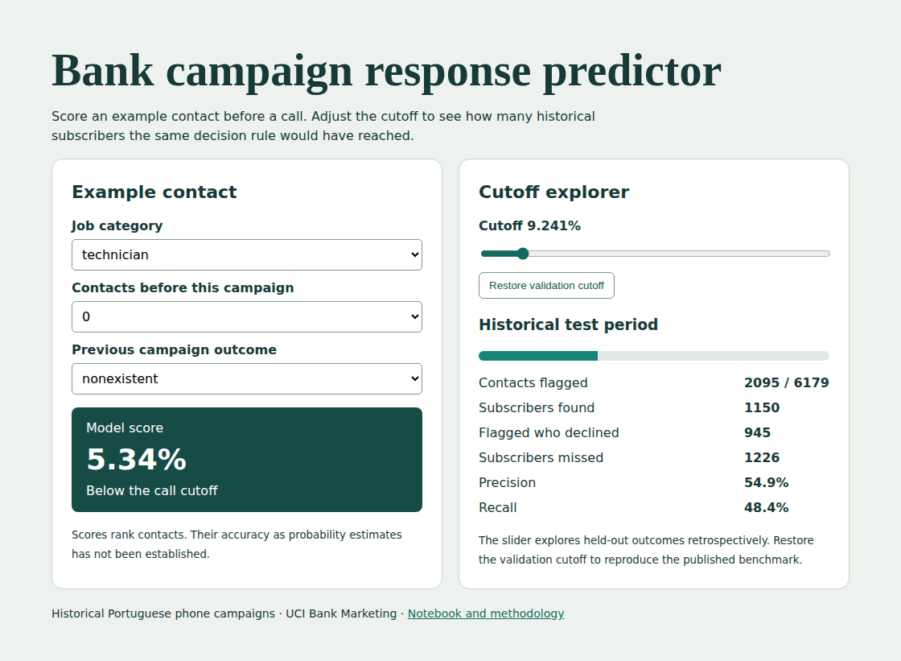

# Bank Campaign Response Prediction

**Can a bank identify likely term-deposit subscribers before a marketing call begins?** This classification project uses historical campaigns from a Portuguese bank to study that decision. The browser dashboard scores example contacts and shows the trade-off between missed subscribers and call volume.

[Open the interactive dashboard](https://shainaulakh.github.io/bank-campaign-response-prediction/dashboard/) · [Explore the master notebook](bank_campaign_response_prediction.ipynb)

On the latest **6,179 historical contacts**, the selected policy flagged **2,095** and found **1,150 of 2,376 subscribers**. Precision reached **54.9%** against a period response rate of **38.5%**. Recall was **48.4%**. The model concentrates subscribers in a smaller list, but misses just over half of them.



## The prediction contract

| Decision | Definition |
|---|---|
| When to score | Immediately before the current call starts |
| What to predict | Whether the contacted customer subscribes to a term deposit (`y`, yes/no) |
| Starting clues | Job category, number of contacts before this campaign and previous campaign outcome |
| Field to exclude | `duration` records the length of the current call. It becomes known only after the call. |
| Scope | Response among previously contacted customers. Estimating whether a call *causes* a subscription would require different evidence. |

## Six project milestones

| Part | Deliverable | Status |
|---|---|---|
| 1 · Define the prediction | Document the source and target, inspect the schema and establish a pre-call feature list | Complete |
| 2 · Explore the campaigns | Reserve later records, measure class balance and explore earlier campaigns | Complete |
| 3 · Prepare the inputs | Build a preprocessing pipeline for numeric fields, categories and unknown values | Complete |
| 4 · Compare models | Evaluate a simple baseline and logistic regression on validation records | Complete |
| 5 · Choose an operating cutoff | Compare precision, recall and call volume, then report held-out results | Complete |
| 6 · Demonstrate the predictor | Publish an interactive dashboard with example inputs, response scores and an adjustable cutoff | Complete |

## Part 2 findings

The date-ordered split assigns 28,831 records to training, 6,178 to validation and 6,179 to testing. All response rates below come from training.

| Training group | Subscriptions / records | Response rate |
|---|---:|---:|
| All records | 1,606 / 28,831 | 5.57% |
| Previous success | 7 / 50 | 14.00% |
| Previous failure | 56 / 952 | 5.88% |
| No previous outcome | 1,543 / 27,829 | 5.54% |

Always predicting “no” would be 94.43% accurate on training records while missing every subscriber. This motivates reporting precision and recall when models are compared. The previous-success group is small, so its higher observed rate should be interpreted cautiously.

## Part 3 · Preprocessing checks

A scikit-learn column transformer converts the earlier-contact count, job and previous outcome into **16 numeric columns**. It learns fill values, scaling parameters and category lists from training records. Applying those rules to validation preserves all 6,178 rows and the same column order.

The executed notebook checks two dashboard edge cases: a missing job activates the observed `unknown` indicator, while an unfamiliar job leaves all job indicators at zero. In both cases the known previous-outcome indicator is preserved.

## Part 4 · Validation results

On the 6,178 validation contacts, logistic regression achieved **0.180 average precision** and **0.589 ROC AUC**. The constant baseline achieved **0.107** and **0.500**, respectively. The higher AP supports carrying logistic regression forward for cutoff selection. At a 0.50 cutoff it flagged **0** contacts and missed **658** subscribers. The ranking and the decision rule answer different business questions.

## Part 5 · Held-out policy results

The validation-selected cutoff was **0.09241** (rounded for display). On validation it flagged 431 of 6,178 contacts. On the 6,179 later test records it flagged **2,095**: **1,150** subscribed and **945** declined. It missed **1,226** of the 2,376 recorded subscribers. Precision was **54.9%**, recall **48.4%**, and F1 **0.514**. The cutoff maximizes validation F1, an illustrative choice in the absence of business cost data. Flagging everyone on the test period yields F1 0.555.

## Part 6 · Run the dashboard

Select a job, the number of prior contacts and the previous outcome. The response score comes from the trained logistic-regression pipeline. Move the cutoff to see how many historical test contacts qualify, and select **Restore validation cutoff** to return to the published operating point. The default policy flagged 2,095 of 6,179 contacts, finding 1,150 subscribers and missing 1,226.

The dashboard contains 84 precomputed example scores and aggregate test counts. It works entirely in the browser. To run it offline, open `dashboard/index.html` from a downloaded checkout. Run the final notebook section to rebuild that file from the fitted pipeline and `dashboard/template.html`.

## Reproduce Parts 1–6

Clone the repository and run these commands in a Windows Miniconda prompt:

```shell
git clone https://github.com/shainaulakh/bank-campaign-response-prediction.git
cd bank-campaign-response-prediction
conda create -n bank-campaign python=3.11 -y
conda activate bank-campaign
python -m pip install -r requirements.txt
mkdir data
curl.exe -fL "https://archive.ics.uci.edu/static/public/222/bank+marketing.zip" -o data/bank-marketing.zip
code .
```

On macOS or Linux, use `curl` in place of `curl.exe`. Open the master notebook from the project root, select the **bank-campaign** kernel and choose **Run All**. The notebook reads the CSV inside the archive directly. Expected dimensions are **41,188 rows × 21 columns**, including the target.

## Interpretation and limitations

The cutoff was selected before test evaluation. Adjusting the slider against the historical test records is a demonstration, not a fresh performance estimate. The subscription rate rose from 5.57% in training to 10.65% in validation and 38.45% in testing. A deployment for another campaign would require fresh chronological evaluation, calibration checks, and an explicit call budget or cost model. The dataset lacks customer identifiers for checking repeat-client overlap. Historical contact outcomes alone cannot show how many subscriptions a call would cause.

## Data and attribution

The notebook uses the date-ordered `bank-additional-full.csv` variant, covering May 2008 through November 2010. These results will describe historical phone campaigns at one institution. A modern campaign would need new validation.

S. Moro, P. Rita and P. Cortez, *Bank Marketing*, UCI Machine Learning Repository. [Dataset and documentation](https://doi.org/10.24432/C5K306) · [Dataset licence · CC BY 4.0](https://creativecommons.org/licenses/by/4.0/)
